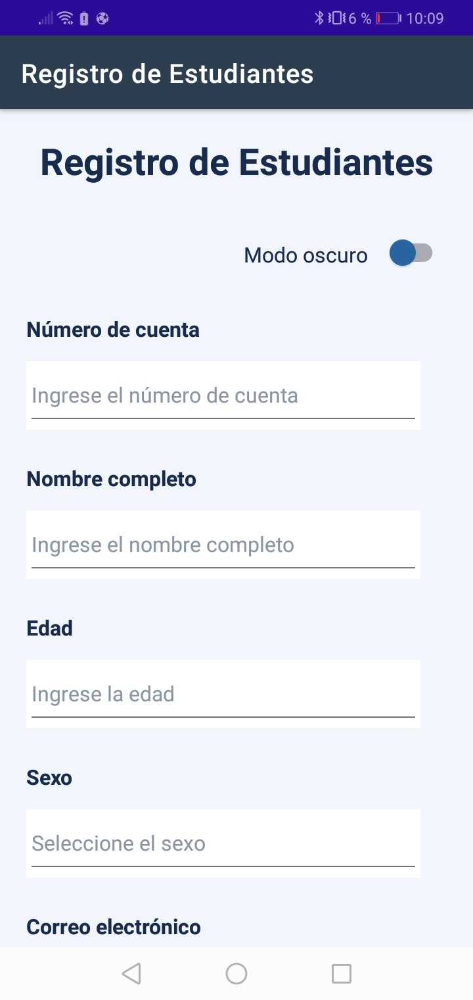
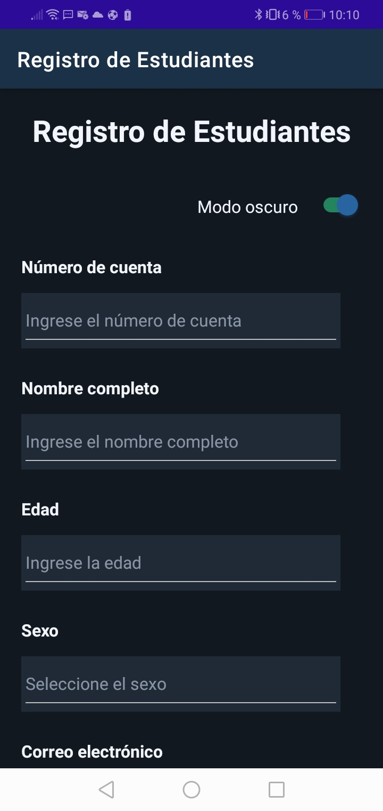

## Capturas de la aplicación

### Modo claro

### Modo oscuro

## 🎨 Paleta de colores

La aplicación RegistroDeEstudiantes utiliza una paleta de colores diseñada para ofrecer una interfaz clara, profesional y adaptable a los modos claro y oscuro.

| Color					| Código hexadecimal | Uso											|

| Azul principal		| `#2864A0`			 | Botones principales y elementos destacados	|
| Azul oscuro			| `#17365D`			 | Elementos de contraste						|
| Verde éxito			| `#23845D`			 | Interruptor y controles de interacción		|
| Fondo claro			| `#F2F6FC`			 | Fondo general en modo claro					|
| Superficie clara		| `#FFFFFF`			 | Campos y superficies en modo claro			|
| Texto oscuro			| `#172B4D`			 | Texto en modo claro							|
| Texto claro			| `#FFFFFF`			 | Texto claro sobre fondos oscuros				|
| Borde claro			| `#CBD5E1`			 | Bordes en modo claro							|
| Fondo oscuro			| `#121820`			 | Fondo general en modo oscuro					|
| Superficie oscura		| `#202A36`			 | Campos y superficies en modo oscuro			|
| Texto del tema oscuro | `#F2F6FC`			 | Texto en modo oscuro							|
| Borde oscuro			| `#536273`			 | Bordes en modo oscuro						|

Los colores están definidos en `Resources/Styles/Colors.xaml`. Se reutilizan mediante recursos XAML y `AppThemeBinding` para adaptar la interfaz al tema seleccionado.